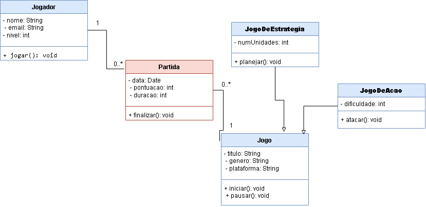

# Projeto de Jogos

## Integrantes

- Danieli
- Eloisa
- Helena
- Jordana

## Tema do Projeto

Nosso tema escolhido foi **jogos**, pois todas nós jogamos e temos interesse nesse conteúdo.

Acreditamos que será um tema muito bom para entendermos melhor os conteúdos trabalhados durante a disciplina e, ao mesmo tempo, desenvolvermos um projeto interessante e divertido para todas nós.

## Diagrama de Classes UML

## Funcionalidades

- Cadastro de jogos, jogadores e partidas.
- Listagem dos registros cadastrados.
- Busca de jogos por título e jogadores por nome.
- Atualização dos dados cadastrados.
- Remoção de jogos, jogadores e partidas.
- Utilização de herança e polimorfismo nas classes de jogos.

## Tecnologias utilizadas

- Java
- Eclipse IDE
- Git e GitHub

## Organização do projeto

- `app`: contém as classes Main e Sistema.
- `model`: contém as classes de jogos, jogadores e partidas.
- `repository`: contém as classes responsáveis pelo CRUD em memória.

## Armazenamento dos dados

Os dados são armazenados temporariamente em listas `ArrayList`, sem utilização de banco de dados nesta etapa.
